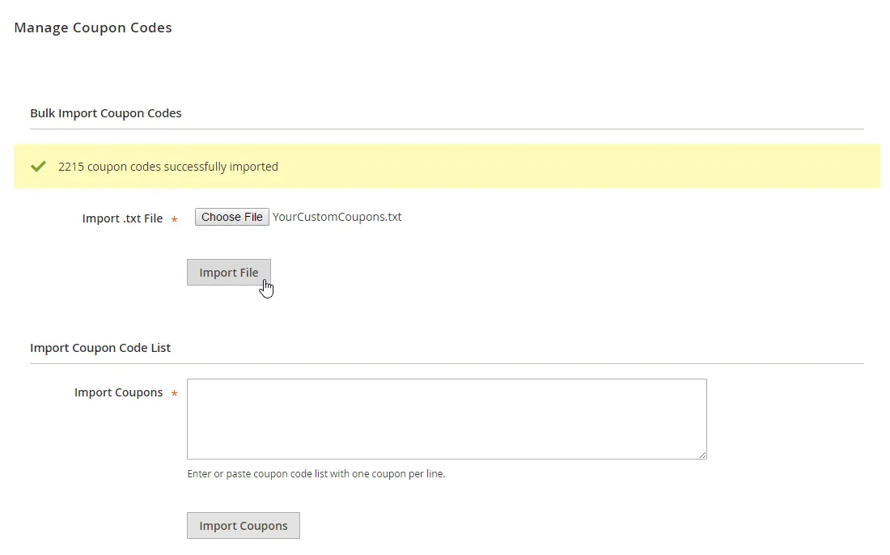
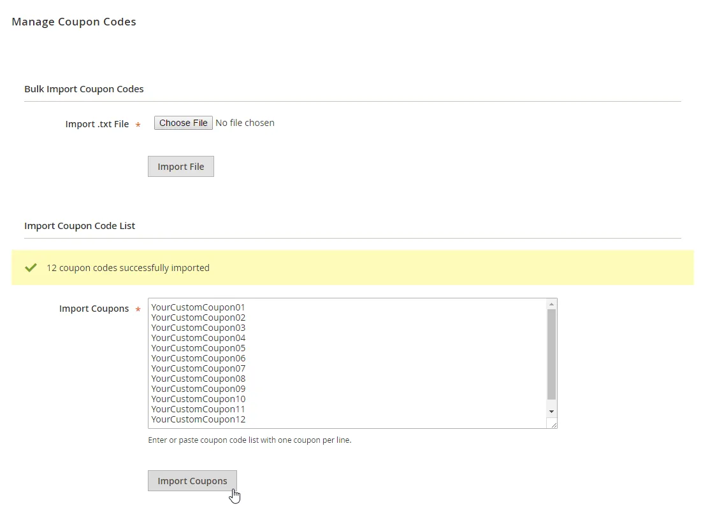
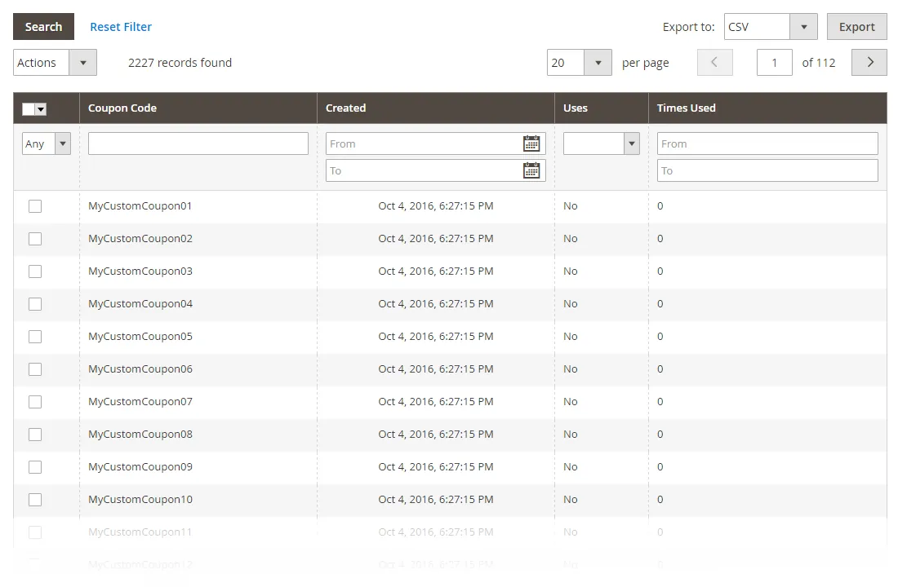

# Coupon Import for Magento 2

**Bulk import of custom coupon codes for Magento 2 cart price rules.**



Imports your own coupon codes into a cart price rule, either pasted as a list or uploaded as a text file.

Useful for personalized codes and codes generated by other systems.

> [!NOTE]
> Coupon Import is free and open source under the MIT License (since 2026). Plugin Company no longer actively develops this extension, but issues and pull requests are welcome.
>
> Version 100.0.11 fixes a security issue in earlier versions; see [CHANGELOG.md](CHANGELOG.md).

## Features

- Bulk import custom coupon codes for cart price rules
- Multiple custom coupons per cart price rule
- Paste a coupon list in the admin
- Upload thousands of codes at once from a text file
- Personalized codes for campaigns and promotions

## Screenshots

<table>
  <tr>
    <td width="50%" valign="top"><br><sub>Upload multiple coupons</sub></td>
    <td width="50%" valign="top"><br><sub>Manage custom coupon codes</sub></td>
  </tr>
</table>

## Compatibility

- **Magento:** 2.1.x – 2.4.x
- **PHP:** 5.5 – 8.3 (Composer constraint `~5.5.0|~5.6.0|~7.0|~7.1|~7.2|~7.3|~8.0.0|~8.1.0|~8.2.0|~8.3.0`)
- **Latest version:** 100.0.11 (released 2026-10-23)
- **Composer package:** `plugincompany/couponimport`
- **Module:** `PluginCompany_CouponImport`

## Installation

### Composer (recommended)

Run in your Magento 2 root directory:

```bash
composer config repositories.plugin.company composer https://plugin.company/
composer require plugincompany/couponimport
bin/magento module:enable PluginCompany_CouponImport
bin/magento setup:upgrade
```

The plugin.company Composer repository is public and points to the release tags of this GitHub repository; no account or credentials are needed. In production mode also run `bin/magento setup:di:compile` and `bin/magento setup:static-content:deploy`, then `bin/magento cache:flush`.

### Manual installation (ZIP)

Download the ZIP of the latest release from the [tags page](https://github.com/PluginCompany/magento2-coupon-import/tags) ([100.0.11](https://github.com/PluginCompany/magento2-coupon-import/archive/refs/tags/100.0.11.zip)) and copy its contents to `app/code/PluginCompany/CouponImport/`, so that `app/code/PluginCompany/CouponImport/registration.php` exists:

```bash
unzip magento2-coupon-import-100.0.11.zip
mkdir -p app/code/PluginCompany/CouponImport
cp -R magento2-coupon-import-100.0.11/. app/code/PluginCompany/CouponImport/
bin/magento module:enable PluginCompany_CouponImport
bin/magento setup:upgrade
```

See the [installation guide](docs/02-installing-the-extension.md) for the complete step-by-step instructions.

### Upgrading from a purchased copy

If you bought this extension from plugin.company before, you can switch to this open-source release without a license key. Your configuration and data stay as they are.

1. Keep the `plugin.company` repository entry in your `composer.json`: it now serves these GitHub releases with the same package names and version numbers. Credentials for plugin.company in `auth.json` are no longer needed.
2. Remove `plugincompany/licensemanager` from the `require` section of your `composer.json` if it is listed there.
3. Run `composer update plugincompany/couponimport plugincompany/licensemanager` (or simply `composer update`), then `bin/magento setup:upgrade`.

If you installed the ZIP into `app/code/`, replace the files in `app/code/PluginCompany/CouponImport/` with this release. The License Manager module (`app/code/PluginCompany/LicenseManager/`) is not needed by these releases; once all your Plugin Company extensions are updated you can disable it with `bin/magento module:disable PluginCompany_LicenseManager`, delete the folder and run `bin/magento setup:upgrade`.

## Documentation

- [Documentation in this repository](docs/README.md) (Installation Guide, User Manual)
- Online documentation: <https://plugin.company/knowledge-base/docs/magento2-coupon-import/>
- Product page: <https://plugin.company/magento-extensions/coupon-import.html>
- Magento 1 / OpenMage version: [magento1-coupon-import](https://github.com/PluginCompany/magento1-coupon-import)

## Changelog

See [CHANGELOG.md](CHANGELOG.md) for the release history.

## Contributing

Found a bug or have an improvement? Please open an [issue](https://github.com/PluginCompany/magento2-coupon-import/issues) or send a [pull request](https://github.com/PluginCompany/magento2-coupon-import/pulls). Since the extension is no longer actively developed by Plugin Company, fixes from the community are the best way to keep it working on current Magento 2 and PHP versions.

## License

Plugin Company's code in this repository is released under the [MIT License](LICENSE), Copyright (c) 2014-2026 Plugin Company.

Bundled third-party libraries keep their own licenses; see [THIRD-PARTY-NOTICES.md](THIRD-PARTY-NOTICES.md) for the full list.
