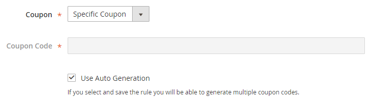
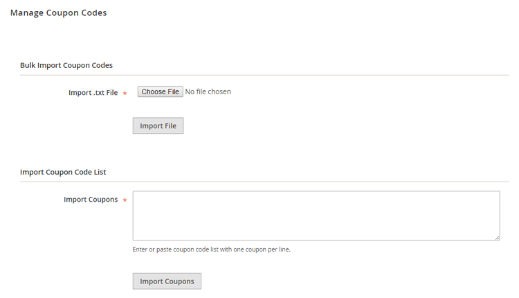
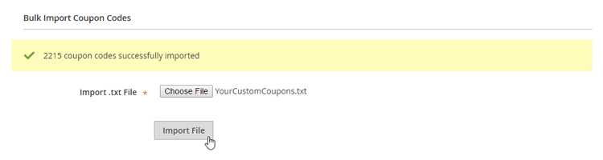
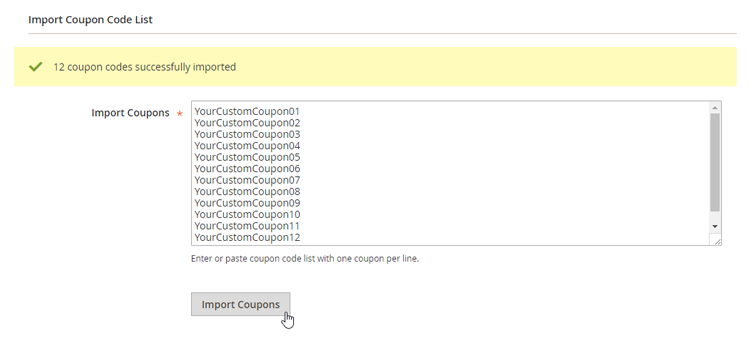
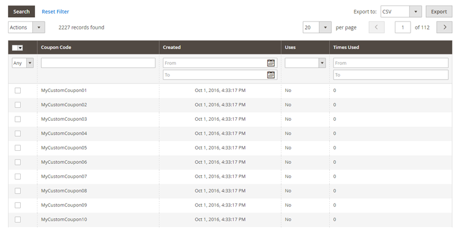

# Importing Coupon Codes in Magento 2

To import custom coupon codes in Magento 2, navigate to **Marketing > Cart Price Rules** in the left Admin Panel menu.

Select a shopping cart price rule from the overview or click the 'Add New Rule' button in the top right corner of the screen to create a new rule.

In the Rule Information tab, select 'Specific Coupon' from the 'Coupon' dropdown menu and tick the 'Use Auto Generation' checkbox, then save the shopping cart price rule.

After saving the rule, open the Manage Coupon Codes tab at the bottom of the price rule page to bulk import your coupons from a text file or to upload a custom coupon list.

## Bulk Importing Coupon Codes

If you want to import a large amount of custom coupons at once you can upload them using a text (.txt) file in the Bulk Import Coupon Codes section.

In order to import a text file, make sure that your coupons are entered in a **list format with one coupon per line**.

Click the 'Choose File' button to select the text file and then 'Import File' to start the upload.

After the coupons are successfully imported a confirmation message will appear at the top of the Bulk import Coupon Codes section.

## Importing Custom Coupon List

If you only need to import a limited amount of custom coupons, you could simply enter them in the text area of the Import Coupon Code List section, or copy-paste them from another source like an Excel sheet or a website.

Make sure you enter or paste the coupons using a **list format with one coupon per line** and click the 'Import Coupons' button to upload them.

After the coupon codes are successfully imported a confirmation message will appear at the top of the Import Coupon Code List section.

## Managing Imported Coupon Codes

Because the Coupon Import extension is AJAX-based, imported coupon codes are instantly added to the overview at the bottom of the Manage Coupon Codes tab without refreshing the price rule page.

You can upload an unlimited amount of custom discount codes at once, however extremely large amounts might take some time to process, while relatively small amounts (e.g. a couple of thousands) are imported almost instantly.

---

[Documentation index](./README.md) · [README](../README.md) · [Online version](https://plugin.company/knowledge-base/docs/magento2-coupon-import/user-manual/importing-coupon-codes-in-magento2/)
